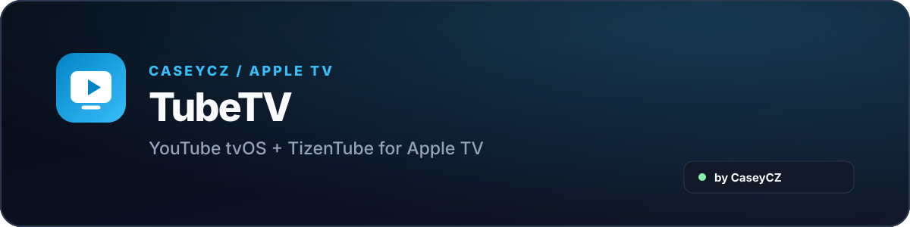

<p align="center">
  
</p>

<p align="center">
  
  <a href="README_EN.md"></a>
</p>

<p align="center">
  YouTube pro Apple TV s rozšířeními <strong>TizenTube</strong>, blokováním reklam a zachovaným nativním tvOS přehráváním.
</p>

<p align="center">
  
  
  
</p>

<p align="center">
  <a href="https://github.com/CaseyCZ/TubeTV/releases/tag/v1.0.0"></a>
  <a href="PATCHING.md"></a>
  <a href="https://github.com/CaseyCZ/TubeTV/issues"></a>
</p>

## O projektu

**TubeTV** je nezávislá úprava YouTube pro Apple TV zaměřená na stabilní přehrávání a praktická TV rozšíření bez nahrazování původního tvOS přehrávače.

Aktuální stabilní verze používá ověřený **YouTube tvOS 4.54.01** runtime a doplňuje ho o **TizenTube**. Díky tomu zůstává zachované původní YouTube / Cobalt rozhraní, přihlášení, titulky, seek, kodeky a chování Apple TV Remote.

## Hlavní funkce

- 📺 původní YouTube / Cobalt rozhraní
- 🚫 blokování reklam přes TizenTube
- ⏭️ volitelný **SponsorBlock** přímo v nastavení TizenTube
- ⚡ rychlost přehrávání a další TV funkce TizenTube
- 🔐 standardní YouTube přihlášení
- 💬 titulky a původní přehrávací cesta YouTube tvOS
- 🎮 nativní ovládání Apple TV Remote
- 📦 vlastní TubeTV identita `cz.caseycz.tubetv`
- 🍎 kompatibilita s `AppleTV5,3`, `AppleTV6,2` a `AppleTV11,1`

## Aktuální release

**TubeTV 1.0.0 Stable** je aktuální produkční verze.

| Položka | Hodnota |
|---|---|
| Základ | YouTube tvOS **4.54.01** |
| Ověřené zařízení | Apple TV HD (`AppleTV5,3`) |
| Bundle ID | `cz.caseycz.tubetv` |
| Rozhraní | původní YouTube / Cobalt |
| Feature vrstva | TizenTube |
| SponsorBlock | volitelný |
| Release soubor | `TubeTV-Stable.ipa` |

Aktuální sestavení je dostupné v **[GitHub Releases](https://github.com/CaseyCZ/TubeTV/releases/tag/v1.0.0)**.

Experimentální **TubeTV Blue UI** není součástí stabilní verze.

## Architektura

TubeTV zachovává YouTube tvOS jako hlavní runtime a přehrávací vrstvu. Projekt přidává vlastní identitu aplikace, ověřené ARM64/Cobalt patche a TubeTV/TizenTube injekci.

Tento přístup minimalizuje zásahy do části aplikace odpovědné za samotné přehrávání a umožňuje další verze stavět nad stejným ověřeným základem.

## Zdrojový kód a další vývoj

`Master` obsahuje veškerý **TubeTV-specifický zdroj**, který potřebujeme pro opravy a další verze:

- `tools/build_tubetv.py` — reprodukovatelný builder IPA/TIPA
- `patches/tubetv-stable-v1.js` — stabilní TubeTV/TizenTube injekce pro v1.0.0
- `patches/youtube-4.54.01.json` — ověřené patch adresy, metadata a SHA-256 kontroly
- `patches/youtube-4.54.01-native.hex` — ARM64 native patch blok
- `BASE_INPUT.md` — přesný fingerprint podporovaného základního balíku
- `PATCHING.md` — kompletní build a vývojový postup

Jediná věc, která **není v Git repozitáři**, je základní `Tube.tipa` s YouTube tvOS 4.54.01 runtime. Ta je uložená lokálně a `.gitignore` záměrně ignoruje `*.tipa` a `*.ipa`.

Doporučené lokální rozložení po naklonování repozitáře:

```text
TubeTV/
├── Tube.tipa                 # lokální základ, není commitovaný
├── tools/
│   └── build_tubetv.py
├── patches/
├── PATCHING.md
└── BASE_INPUT.md
```

Pak lze aktuální stabilní IPA znovu sestavit přímo:

```bash
python3 tools/build_tubetv.py Tube.tipa -o TubeTV-Stable.ipa
```

Builder ověří celý vstupní balík, verzi, bundle ID, executable i očekávané native patch pozice. Přesná identifikace lokálního vstupu je v **[BASE_INPUT.md](BASE_INPUT.md)**.

Podrobnosti pro další verze jsou v **[PATCHING.md](PATCHING.md)** a **[patches/README.md](patches/README.md)**.

## Zásluhy

TubeTV používá nebo navazuje na práci těchto open-source projektů:

- **TizenTube** — https://github.com/reisxd/TizenTube — GPL-3.0-only
- **μTube** — https://github.com/Exaphis/mutube — reference pro Apple TV / Cobalt patching

Další informace jsou v **[THIRD_PARTY_NOTICES.md](THIRD_PARTY_NOTICES.md)**.

## Důležité

TubeTV je nezávislý komunitní projekt a není oficiálně spojený, podporovaný ani schválený společnostmi YouTube, Google nebo Apple ani projekty TizenTube a μTube.

YouTube je ochranná známka Google LLC. Použité projekty, aplikace a komponenty se řídí vlastními licencemi a podmínkami.

## Podpora

<p align="center">
  <a href="https://www.buymeacoffee.com/caseycz"></a>
</p>

<p align="center">
  <a href="https://www.buymeacoffee.com/caseycz"></a><br>
  <sub>Naskenuj QR kód nebo klikni na tlačítko.</sub>
</p>

<p align="center">
  <a href="https://caseycz.github.io/"></a>
</p>
